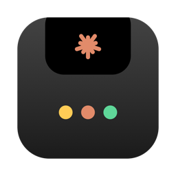
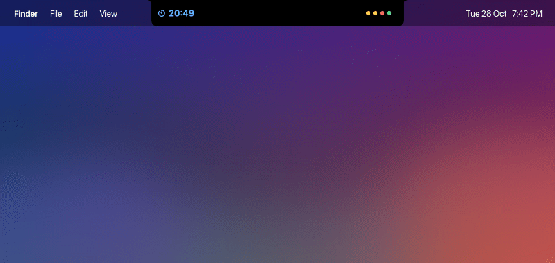
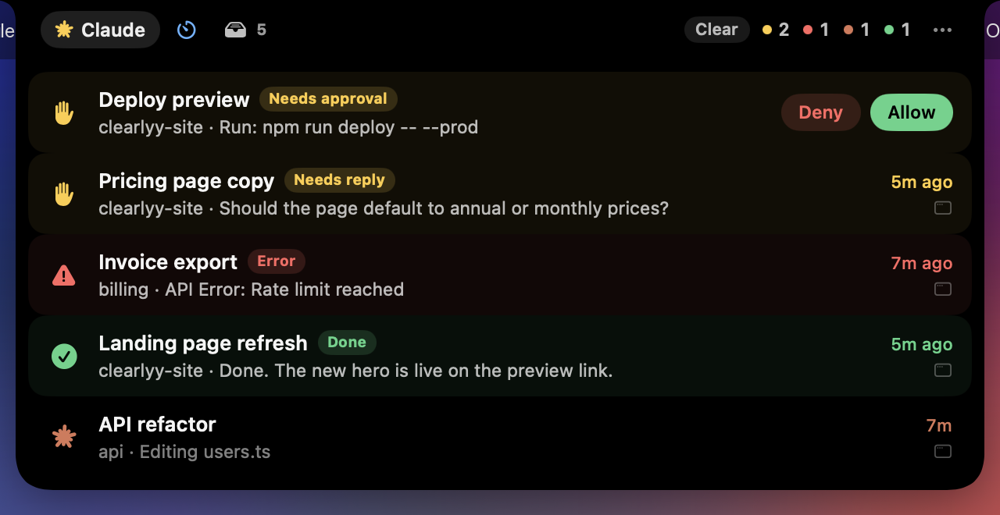
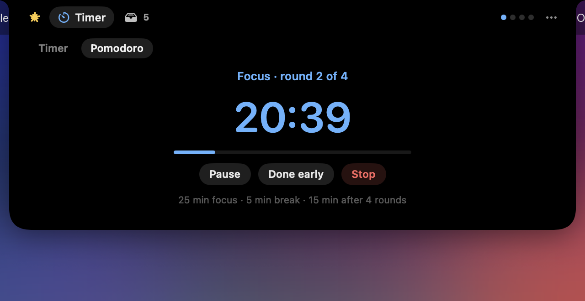
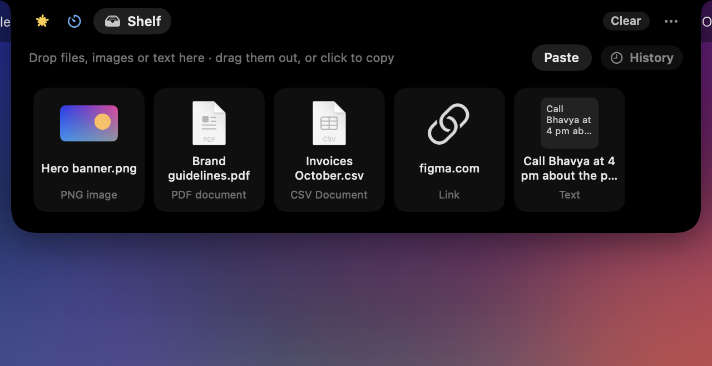
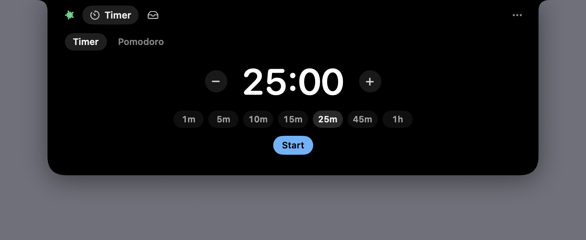
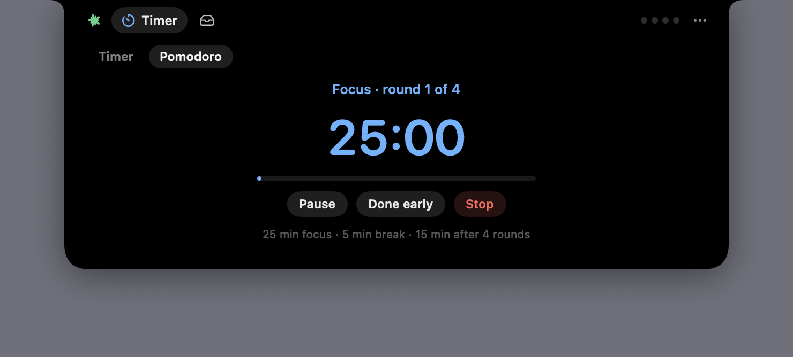
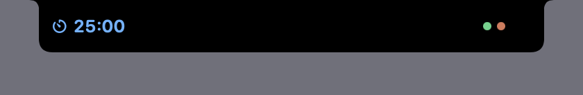
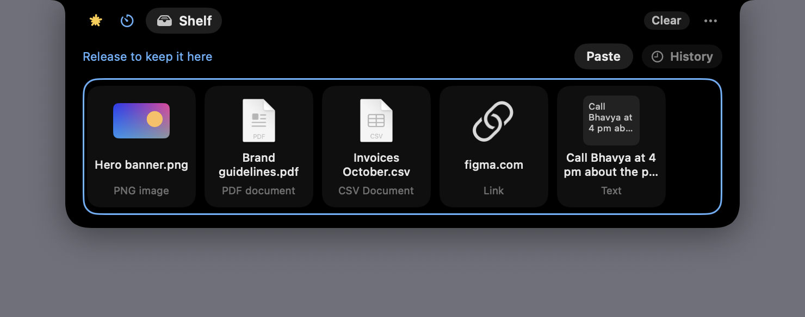

<p align="center">
  
</p>

<h1 align="center">ClaudeNotch</h1>

<p align="center">
  <b>Claude Code, a timer, Pomodoro and a shelf, living in your MacBook's notch.</b><br>
  Watch and answer every Claude Code session, time your focus, and carry files between apps and Spaces, without leaving what you're doing.
</p>

<p align="center">
  <a href="https://github.com/dkumarvaishnav/ClaudeNotch/releases/latest"></a>
  
  
</p>

<p align="center">
  
</p>

<table>
  <tr>
    <th width="33%">Claude Code</th>
    <th width="33%">Timer &amp; Pomodoro</th>
    <th width="33%">Shelf</th>
  </tr>
  <tr>
    <td></td>
    <td></td>
    <td></td>
  </tr>
  <tr>
    <td>Every session, colour-coded. Allow or deny requests, answer Claude's questions and reply, right from the notch.</td>
    <td>Quick timers and 25 / 5 Pomodoro rounds, counting down beside the notch with a chime at the end.</td>
    <td>Drop files, images, links or text on the notch, then take them to another app or Space.</td>
  </tr>
</table>

It floats above the menu bar on every Space, over full-screen apps, and on every display (screens without a notch get a virtual one). Opening and closing are Core Animation springs at 120 fps on ProMotion displays, and it uses about 0.5% CPU when idle.

## Claude Code

Every Claude Code session on your Mac, desktop app or terminal, with what it's doing right now. Inspired by [TwoCode](https://github.com/levon-z/TwoCode) (a Dynamic Island for Windows), rebuilt natively for macOS.

| | |
| --- | --- |
|  | **Collapsed.** One dot per active session, in its colour. The spark takes the most urgent colour, spins while anything works, and pulses when something needs you. |
|  | **Click a session** for the full story: the exact command or diff it wants to run, **Deny** (optionally saying what to do instead), **Always allow**, **Allow**. Simple requests also get Deny / Allow right in the list. |
|  | **Questions and plans.** Pick an answer (or type your own) when Claude asks you something; approve a plan or send it back with feedback. |
|  | **Finished work** shows Claude's whole reply. Type in the box to **reply or give the next instruction**, and Claude wakes up and carries on. |

### Colours

- 🟡 **Yellow, needs you.** Waiting for a permission, a question, a plan review, or its reply asks you something.
- 🔴 **Red, error.** The turn stopped on an API error (rate limit, overload, …). Open it to retry.
- 🟢 **Green, done.** Finished with a result you haven't looked at yet.
- 🟠 **Orange, working.**
- ⚪ **Grey, nothing new.**

When a session finishes, fails or needs you, the notch pops open for 4 seconds and folds back by itself. The coloured dot stays, so you can walk away and still see it from across the room. Hovering doesn't clear colours either. A session goes grey once you open it, reply, click ✕ / **Mark as seen** / **Clear**, or start a new turn.

## Timer and Pomodoro

| | |
| --- | --- |
|  | **Timer.** Pick a preset or nudge it with − / +, then Start. Pause, resume or reset any time. |
|  | **Pomodoro.** 25 min focus, 5 min break, a 15 min break after 4 rounds. Breaks start by themselves; the next focus round waits for you. **Done early** and **Skip break** move on. |
|  | **Beside the notch.** While a countdown runs, it sits to the left of the notch (blue for focus, mint for breaks) and your session dots stay on the right. When it ends you hear a chime and get a 4-second pop-up. |

Timers survive a restart of the app; a countdown that ran out while it was closed just ends.

## Shelf



Drag files, images, links or text onto the notch from any app; it opens as a drop target. Switch Space or app, then drag them back out, or click one to copy it. **Paste** adds what you copied last. Files stay where they are (the shelf keeps a reference), and the shelf empties when ClaudeNotch quits.

**Clipboard history** (the **History** button, off by default) adds everything you copy to the shelf. macOS asks before an app reads what you copy, so it only records once you set ClaudeNotch to **Allow** under **System Settings → Privacy & Security → Paste from Other Apps**. The **Allow…** button takes you there. Items that password managers mark as private are never recorded.

## Install

You need macOS 14 or later and [Claude Code](https://claude.com/claude-code) (desktop app or CLI).

### Download

1. Get `ClaudeNotch-<version>.dmg` from the [latest release](https://github.com/dkumarvaishnav/ClaudeNotch/releases/latest). It runs natively on Apple-silicon and Intel Macs.
2. Open it and drag **ClaudeNotch** onto **Applications**.
3. Open ClaudeNotch. The app isn't notarized by Apple yet, so the first time macOS says it can't verify it. Go to **System Settings → Privacy & Security**, click **Open Anyway** next to ClaudeNotch, and confirm. You only do this once.

### Build from source

You also need the Xcode Command Line Tools (`xcode-select --install`). Full Xcode isn't needed.

```bash
git clone https://github.com/dkumarvaishnav/ClaudeNotch.git
cd ClaudeNotch
./build.sh --install
```

This builds `ClaudeNotch.app` for your Mac, copies it to `~/Applications`, and starts it.

Either way, right-click the notch → **Launch at Login** to keep it running. On first launch ClaudeNotch asks whether it may add its hooks to `~/.claude/settings.json` (see below). Without them you can still watch every session; you just answer requests in Claude Code itself.

## Use it

- **Hover** the notch to open it, then pick **Claude**, **Timer** or **Shelf** at the top left. Move away to close it.
- **Drag** something to the notch to park it on the shelf.
- **Click a session** for its detail card. It stays open while you read or type, and closes with **Esc**, ✕, or a click outside. **Open ↗** jumps to the session in the Claude desktop app, or brings its terminal or editor to the front.
- **Right-click** the notch (or click `…`) for settings: Allow/Deny & Reply, clipboard history, sounds, pop-ups, all displays, launch at login, quit.

## How it works

**Seeing sessions needs no setup.** Claude Code keeps a live registry of running sessions in `~/.claude/sessions/<pid>.json` (name, folder, status `busy` / `waiting` / `idle`). ClaudeNotch reads it every second, plus the tail of each transcript (`~/.claude/projects/<folder>/<session>.jsonl`) for the current step and how the last turn ended.

**Acting on sessions uses Claude Code hooks.** Once you allow it, ClaudeNotch adds these entries to `~/.claude/settings.json`:

| Hook | What it does |
| --- | --- |
| `PermissionRequest` | Holds the request until you answer in the notch. Claude Code's own dialog stays usable meanwhile; whichever answers first wins. |
| `Stop` (`asyncRewake`) | After a turn ends, waits in the background. What you type in the notch is handed to Claude and wakes it up. |
| `Stop`, `StopFailure`, `UserPromptSubmit`, `SessionEnd` | Tell the notch how turns end (done / error) and when you've moved on. |

**How `settings.json` is edited:**
- Every other setting and hook keeps its value, its order and its exact text. The file is written back in Claude Code's own 2-space layout.
- The previous version is saved as `settings.json.claudenotch-backup`, with the same file permissions.
- A save is refused if anything outside `hooks` would change, if the file can't be read or parsed, or if it changed while being updated.
- A symlinked `settings.json` is written through, so the link is kept.
- Turning the option off removes ClaudeNotch's entries and nothing else.

**Security:**
- Each hook runs `~/.claude/hooks/claudenotch-hook`, a small helper that talks to the app on `127.0.0.1:47852`.
- The helper and the app share a secret in `~/Library/Application Support/ClaudeNotch/token`, readable only by you. The secret is never sent.
- Each request is signed (HMAC-SHA256 over the endpoint, a timestamp, a fresh nonce and the body). The app rejects unsigned, stale or replayed requests.
- The app signs each answer. The helper ignores any answer without a valid signature, so another program listening on the port can't approve anything.
- When ClaudeNotch isn't running, the helper exits without output, and Claude Code behaves as if the hook weren't there.

Nothing leaves your Mac.

**Limits:**
- Replies work for turns that ended while the hooks were on.
- A permission prompt that was already open before ClaudeNotch started has to be answered in Claude Code.
- After an API error, retry from the session itself. Claude Code runs no `Stop` hook in that case.

## Uninstall

1. Right-click the notch and turn off **Allow, Deny & Reply from the Notch**. This removes the hooks from `~/.claude/settings.json`.
2. Quit ClaudeNotch and delete `~/Applications/ClaudeNotch.app`.
3. Optionally, delete `~/.claude/hooks/claudenotch-hook`, `~/Library/Application Support/ClaudeNotch` and `~/.claude/settings.json.claudenotch-backup`.

If you delete the app without step 1, the hooks stay in `settings.json`. They do nothing (the helper exits at once), but you can remove the entries that mention `claudenotch-hook` by hand.

## Develop

```bash
swift build      # debug build (app + helper)
swift test       # unit tests: settings.json editing, transcripts, request details, timer, shelf
./package.sh     # dist/ClaudeNotch-<version>.dmg: universal (Apple silicon + Intel), ad-hoc signed
swift tools/make-icon.swift   # redraw Resources/AppIcon.icns
```

With an Apple Developer ID, `package.sh` can also sign and notarize the disk image, so it opens without any warning. Run `xcrun notarytool store-credentials` once, then pass the certificate and profile (see the top of `package.sh`):

```bash
CODESIGN_IDENTITY="Developer ID Application: Your Name (TEAMID)" NOTARY_PROFILE=claudenotch ./package.sh
```

If the project lives in an iCloud-synced folder (like Desktop), iCloud tags the test bundle and `codesign` refuses it. Build the tests elsewhere: `swift test --scratch-path /tmp/claudenotch-build`.

The version comes from `CFBundleShortVersionString` in `Resources/Info.plist`.

Debug builds have test tools that release builds leave out:

- `CLAUDENOTCH_HOME=/some/fake/home` reads fake sessions and edits a fake `settings.json`, so you can test without touching your real ones.
- `.build/debug/ClaudeNotch --snapshot <dir>` renders the notch states with your sessions to PNGs.
- `CLAUDENOTCH_DEBUG=1` turns on the `ClaudeNotch.debug` distributed notification. Commands:
  - `expand`, `peek`, `collapse`, `detail[:id]`
  - `allow`, `deny`, `answer:<option>`, `reply:<text>`
  - `tab:claude|timer|shelf`, `hold` / `release` (keep the open notch open for screenshots)
  - `timer:<seconds>`, `pomodoro`, `pause`, `resume`, `skip`, `finish`, `reset`, `timer-state`
  - `shelf:text:<text>`, `shelf:file:<path>`, `shelf:image:<png>` (dropped through the same path as a real drag), `droptarget`, `history`, `shelf-state`
  - `shot:<file.png>`: a window-server capture
  - `film:<prefix>,expand|collapse`: frames mid-animation
  - `measure`: the frame rate of one open or close

  It's off by default because any local process can post one.

| File | What |
| --- | --- |
| `SessionStore.swift` | Registry + transcripts + hook info → sessions, colours, "seen" state, alerts |
| `Transcript.swift` | Reads a transcript tail: current step, how the turn ended, the reply, recent steps |
| `HookServer.swift` / `HookHub.swift` | Local server for the helper; pending permissions, reply waits, your decisions |
| `HookInstaller.swift` | Order-preserving edit of `settings.json`, helper install |
| `HookProtocol/HookAuth.swift` | Signing shared by the app and the helper |
| `ClaudeNotchHook/main.swift` | The helper Claude Code runs |
| `NotchViews.swift` | SwiftUI: list, detail card (approve, answer, review plan, reply) |
| `ModuleViews.swift` | SwiftUI: tab header, timer and Pomodoro pages, countdown beside the notch, shelf |
| `TimerStore.swift` | Timer and Pomodoro: one end date, one one-shot alarm, saved across restarts |
| `ShelfStore.swift` | Shelf items, drops, copy back, drag out, opt-in clipboard history |
| `NotchContainer.swift` | The notch shape, shadow and content mask, animated with Core Animation springs |
| `NotchWindow.swift` | The panel above the menu bar; hover, pop-up, detail and focus handling |
| `AppDelegate.swift` | Displays, mouse/keyboard, sounds, menu, settings |

## License

[MIT](LICENSE). ClaudeNotch is an independent project, not affiliated with or endorsed by Anthropic. Claude and Claude Code are trademarks of Anthropic.
